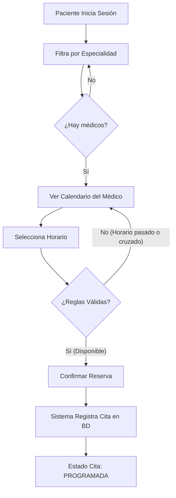
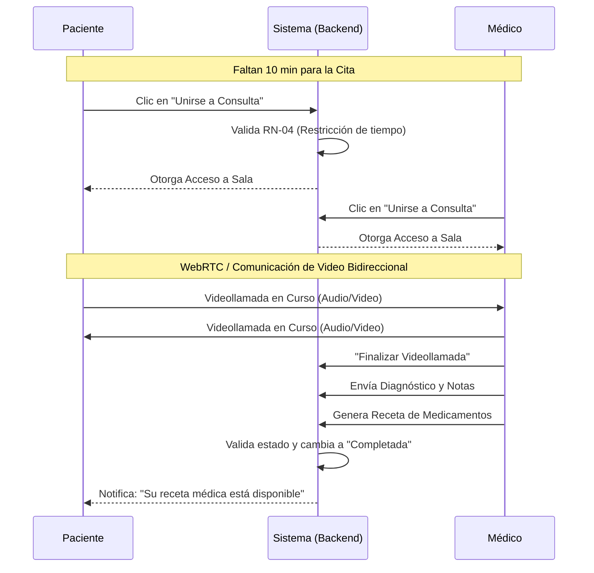

# Casos de Uso y Flujos de Negocio
**Proyecto:** Sistema de Telemedicina (Variante 8)

---

## 1. Casos de Uso Principales (La Interacción)

Los Casos de Uso describen la interacción paso a paso entre los Actores (Paciente, Médico) y el Sistema para lograr un objetivo específico.

### CU-01: Agendar Cita Médica
* **Actor Principal:** Paciente
* **Precondición:** El paciente debe tener una cuenta activa y haber iniciado sesión.
* **Flujo Principal:**
  1. El paciente accede a la sección "Agendar Cita".
  2. El paciente filtra la búsqueda por una "Especialidad" (ej. Cardiología).
  3. El sistema muestra la lista de médicos disponibles en esa especialidad.
  4. El paciente selecciona a un médico y solicita ver su calendario.
  5. El sistema cruza la "Disponibilidad" del médico con las citas ya "Programadas" y muestra solo los bloques de tiempo libres.
  6. El paciente selecciona un horario y confirma.
  7. El sistema guarda la cita con estado `Programada` y genera el enlace único para la futura videollamada.
* **Postcondición:** La cita aparece en el Dashboard del paciente y en la agenda del médico.

### CU-02: Atender Consulta por Videollamada
* **Actores:** Paciente y Médico
* **Precondición:** Debe existir una cita en estado `Programada`.
* **Flujo Principal:**
  1. El actor ingresa a su Dashboard.
  2. Si faltan 10 minutos o menos para la hora de la cita (Regla de Negocio RN-04), el sistema habilita el botón "Unirse a Consulta".
  3. Ambos actores hacen clic en el botón.
  4. El sistema los redirige a una sala de videollamada virtual única.
  5. Al finalizar la interacción en video, el médico hace clic en "Finalizar Llamada".
  6. El sistema redirige al médico a la pantalla de "Cierre de Consulta".

### CU-03: Cierre de Consulta y Receta Médica
* **Actor Principal:** Médico
* **Precondición:** Haber finalizado la videollamada del CU-02.
* **Flujo Principal:**
  1. El médico redacta el "Diagnóstico" y las "Notas Clínicas" en el formulario.
  2. El médico agrega los medicamentos, dosis y duración a la "Receta Digital".
  3. El médico hace clic en "Completar Consulta".
  4. El sistema cambia el estado de la cita a `Completada`.
  5. El sistema envía una notificación al paciente indicando que su receta está lista para descargar en PDF.

---

## 2. Diagramas de Flujo (Workflows)

### 2.1 Flujo Visual: Agendamiento de Citas
Este diagrama muestra las decisiones lógicas (If/Else) que el sistema debe hacer para evitar citas duplicadas.

### 2.2 Diagrama de Secuencia: Videollamada y Receta
Este diagrama de secuencia ilustra la comunicación temporal y bidireccional entre los actores y el Backend.

