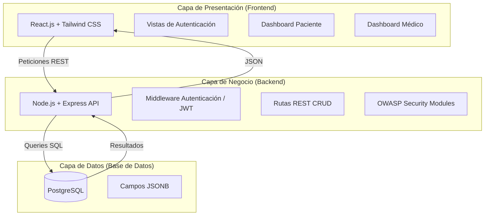
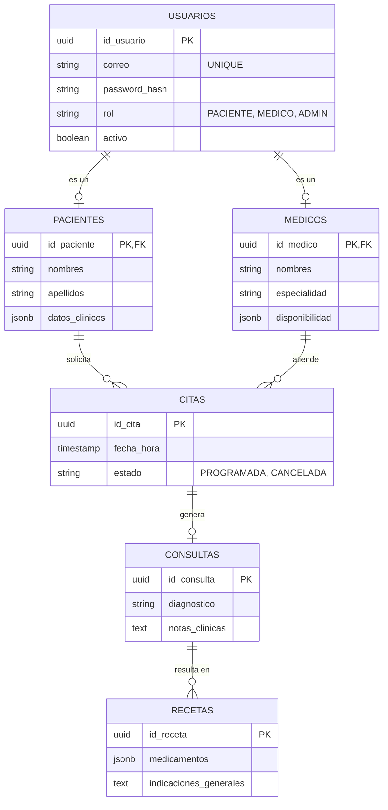

# Documentación Inicial - Sistema de Telemedicina (Variante 8)

## 1. Descripción del Problema
En la actualidad, la información médica de los pacientes suele estar fragmentada entre distintas clínicas, hospitales y consultorios. Esto dificulta que un médico tenga acceso rápido al historial completo de un paciente, lo que puede provocar diagnósticos erróneos o interacciones medicamentosas peligrosas. Además, la gestión de citas de forma manual o telefónica es ineficiente y propensa a errores.

**Solución:** 
Desarrollar una plataforma web centralizada de telemedicina que permita:
1. Conectar a pacientes y médicos de forma digital.
2. Agendar y gestionar consultas médicas en línea según la disponibilidad del médico.
3. Mantener un Expediente Clínico centralizado y seguro para cada paciente.
4. Emitir recetas médicas vinculadas directamente a la consulta.

---

## 2. Arquitectura del Sistema
El proyecto implementa un patrón de **Arquitectura de 3 Capas** (Cliente-Servidor) para garantizar la escalabilidad, el mantenimiento y la separación de responsabilidades.

### Componentes de la Arquitectura:
* **Frontend:** Desarrollado con React. Se encargará del enrutamiento en el cliente, validación de formularios, consumo de la API REST y diseño responsivo usando Tailwind CSS.
* **Backend:** Desarrollado con Node.js y Express. Expondrá una API RESTful segura. Implementará validaciones, manejo de roles (RBAC) y mitigación de vulnerabilidades (OWASP Top 10).
* **Base de Datos:** PostgreSQL. Base de datos relacional para garantizar la integridad de los datos (ACID), utilizando el tipo de dato `JSONB` para almacenar estructuras dinámicas como recetas y datos clínicos sin requerir un exceso de tablas relacionadas.

---

## 3. Modelo de Base de Datos
El esquema relacional centraliza a los usuarios y ramifica los roles (Pacientes y Médicos).

---

## 4. Flujo de Usuario y Wireframes Lógicos
Las vistas principales del sistema se dividen según el rol del usuario autenticado.

### 4.1. Flujo General (Registro y Autenticación)
1. **Pantalla de Login:** Ingreso con correo y contraseña.
2. **Pantalla de Registro:** Creación de cuenta. El usuario selecciona si es Médico o Paciente y llena sus datos personales.

### 4.2. Flujo del Paciente
* **Dashboard Paciente:** Muestra las próximas citas agendadas.
* **Agendar Cita:** Panel de búsqueda de médicos por especialidad. Al seleccionar un médico, se lee su columna `disponibilidad` (JSONB) para mostrar horarios libres.
* **Mi Expediente:** Vista de solo lectura con su historial de consultas pasadas y recetas emitidas.
*(Ver `/docs/mockup_paciente.jpg`)*

### 4.3. Flujo del Médico
* **Dashboard Médico:** Agenda diaria interactiva con las citas del día actual.
* **Atender Consulta:** Pantalla donde el médico ingresa el diagnóstico, las notas clínicas y prescribe los medicamentos (guardados en JSONB).
* **Expedientes de Pacientes:** Lista de pacientes que el médico ha atendido, con acceso a su historial clínico completo.
*(Ver `/docs/mockup_medico.jpg`)*
